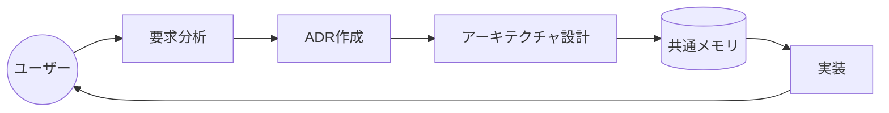
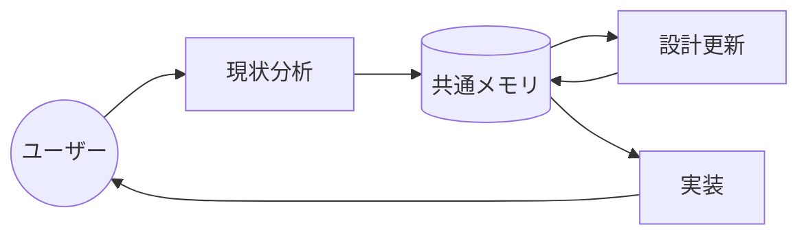

# 【開発標準】AI共創型開発ワークフローガイド（OpenCode × Cherry Studio × Ollama）

## 1. 基本思想
本ドキュメントは、LLM（大規模言語モデル）を単なるコード生成ツールではなく、**「思考のパートナー」**として開発プロセスに組み込むための指針である。

**「思考の三位一体」**を定義する：
- **Cherry Studio** = システムを理解し、**「考える」**場所
- **OpenCode Analyst** = 既存の資産を読み取り、**「理解する」**場所
- **OpenCode Coder** = 100%の実装を**「作る」**場所
- **共通メモリ** = 全ての知見を統合し、**「記憶する」**共通メモリ

---

## 2. 思考の指針（Analysis Principles）
すべての分析フェーズにおいて、以下の5つの視点から多角的な分析を行う。これは、技術的な指針のみならず、ビジネスや社会への影響を考慮するための共通指針である。

1.  **機能的要求 (Functional)**: 「何ができるか？」
2.  **ユーザーの要求 (User Experience)**: 「誰が、どう使うか？」
3.  **スポンサーの要求 (Business)**: 「ビジネス価値、優先順一、予算、納期」
4.  **組織の要求 (Organizational)**: 「社内標準、技術スタック、セキュリティ、保守性」
5.  **社会の要求 (Social/Legal)**: 「法令遵守、プライバシー、倫理、アクセシビリティ」

---

## 3. 役割定義（Role Definition）
思考の指針に基づき、以下の役割を各ツールに割り当てる。

| 役割 | 担当ツール | 主な役割 | キーワード | 利用対象 |
| :--- | :--- | --- | --- | --- |
| **Analyst (思考)** | **Cherry Studio** | 要求分析、業務分析、ADR作成、技術選定、アーキテクチャ設計、画像/PDF分析 | **概念** | 要件、設計書、図表、写真 |
| **Analyst (理解)** | **OpenCode Analyst** | コード読解、リファクタリング分析、PRレビュー、依存関係分析、技術的負債調査 | **コード** | ソースコード、Git Diff、ログ |
| **Coder (実装)** | **OpenCode Coder** | 実装、テスト生成、修正、コード変換 | **生成** | ソースコード |

---

## 4. 開発フローの分岐
プロジェクトの性質に応じて、以下の2つのフローを使い分ける。

### A. 新規開発（Greenfield）
**「要件」から「理想の姿」を構築するフロー。**
*   **特徴:** 自由度が高く、**「何を、どう作るか」**の定義に集中する。
*   **フロー:**
    1.  **要求分析 (Cherry Studio Analyst)**: 5つの視点から要件を抽出。
    2.  **ADR作成 (Cherry Studio Analyst)**: 設計方針を決定。
    3.  **アーキテクチャ設計 (Cherry Studio Analyst)**: システム構成を定義。
    4.  **共通メモリ更新 (Markdown)**: 設計を反映。
    5.  **実装 (OpenCode Coder)**: 実装とテスト生成。

### B. エンハンスメント（Brownfield）
**「既存の資産」をベースに、制約を考慮した拡張を行うフロー。**
*   **特徴:** **「既存の制約」**を深く理解し、安全な拡張を追求する。
*   **フロー:**
    1.  **現状分析 (OpenCode Analyst)**: 既存コードの依存関係と制約を徹底調査。
    2.  **影響範囲の特定 (OpenCode Analyst)**: 変更が及ぼす影響を特定。
    3.  **設計更新 (Cherry Studio Analyst)**: 既存の制約を考慮した設計を策定。
    4.  **共通メモリ更新 (Markdown)**: 変更方針を反映。
    5.  **実装 (OpenCode Coder)**: 整合性を保ちつつ実装。

---

## 5. 共通メモリとインタラクティブな循環
**共通メモリ**は、単なる成果の記録ではなく、プロジェクトの**「Single Source of Truth (SSOT)」**として機能する。

*   **同期ポイント:** AIとの対話から抽出された合意事項（ADR、設計、分析結果）を、構造化されたデータとして記録。
*   **合意の動的更新:** ユーザーからのフィードバックや、実装中に発見された制約を即座に反映。
*   **共通認識:** 常に最新の**「合意された事実」**を共通メモリに反映し、すべてのエージェントがこれを確認・参照する。

### インタラクティブなループ
開発は直線的なプロセスではなく、**「実装と分析の相互作用」**によって進化する。
*   **実装中の発見:** Coderが実装中に技術的制約や予期せぬ事象を発見した場合、即座にAnalystへフィードバック。
*   **ユーザーのフィードバック:** ユーザーからの修正依頼や追加要求は、常に「要求分析」のプロセスに戻り、設計（ADR）を再評価する。

---

## 6. 運用方針（Operational Principles）

### 6.1 共通メモリの管理
**共通メモリ**は、プロジェクトの「共通認識」を維持するための**Single Source of Truth (SSOT)** として機能する。

*   **保存場所:**
    *   `docs/architecture/`: アーキテクチャ設計、ADR、技術選定の記録
    *   `.opencode/shared/`: 開発中の動的な合意、中間的な分析結果
    *   `docs/ai-findings/`: AIによる分析結果、リファクタリングの指摘事項
*   **ADR（Architecture Decision Records）の標準:**
    *   **Context (背景):** なぜこの決定が必要になったか。
    *   **Decision (決定事項):** 最終的に採用する技術や設計。
    *   **Alternatives (代替案):** 検討した他の選択肢と、なぜそれを選ばなかったかの理由。
    *   **Consequences (影響):** この決定によって生じるメリットと、想定されるトレードオフ。

### 6.2 データの安全性とプライバシー
*   **ローカル優先:** 機密性の高いデータは、必ずローカルモデル（Ollama等）を使用する。
*   **抽象化の徹底:** クラウドモデル（Big Pickle等）を使用する場合、機密情報は必ず抽象化（伏せ字、プレースホルダー）してから入力する。
*   **コンテキストの最適化:** 毎ターン送信される情報量を最適化し、不要な履歴は圧縮または削除する。

### 6.3 モデル構成（Model Configuration）
| 役割 | モデル | num_ctx | thinking | temperature | 特徴 |
| :--- | :--- | --- | --- | --- |
| **Analyst** | Gemma 4 | 32,768 | true | 0.2 | 高度な推論、多角的な分析 |
| **Coder** | Qwen 3.5 | 32,768 | false | 0.0 | 実装速度、正確なコード生成 |
| **Large Context** | Gemma 4 | 65,536 | true | 0.2 | 巨大なログ、横断分析 |

---

*本ドキュメントは、チーム内の開発効率と品質を最大化するための標準指針です。*

