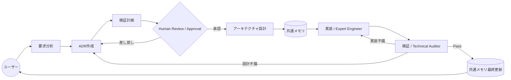
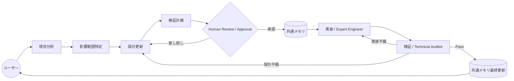

# 【開発標準】AI共創型開発ワークフローガイド（OpenCode × Cherry Studio × Ollama）

## 1. 基本思想
本ドキュメントは、LLM（大規模言語モデル）を単なるコード生成ツールではなく、**「思考のパートナー」**として開発プロセスに組み込むための指針である。

**「共創の役割分担」**を定義する。モデル（ペルソナ）と利用ツールは分離して考え、同じ `ta:architect` を Cherry Studio と OpenCode の両方で利用できる。

- **Cherry Studio / Analyst（Ethical Architect）** = 要件を分析し、**「考える」**場所
- **OpenCode Analyst（Ethical Architect）** = 既存の資産を読み取り、**「理解する」**場所
- **OpenCode Coder（Expert Engineer）** = 100%の実装を**「作る」**場所
- **OpenCode Auditor（Technical Auditor）** = 実装を検証し、**「保証する」**場所
- **共通メモリ** = 全ての知見を統合し、**「記憶する」**共通メモリ

---

## 2. 思考の指針（Analysis Principles）
すべての分析フェーズにおいて、以下の5つの視点から多角的な分析を行う。これは、技術的な指針のみならず、ビジネスや社会への影響を考慮するための共通指針である。

1.  **機能的要求 (Functional)**: 「何ができるか？」
2.  **ユーザーの要求 (User Experience)**: 「誰が、どう使うか？」
3.  **スポンサーの要求 (Business)**: 「ビジネス価値、優先順位、予算、納期」
4.  **組織の要求 (Organizational)**: 「社内標準、技術スタック、セキュリティ、保守性」
5.  **社会の要求 (Social/Legal)**: 「法令遵守、プライバシー、倫理、アクセシビリティ」

---

## 3. 役割定義（Role Definition）
思考の指針に基づき、以下の役割を各ツールに割り当てる。

| 役割 | 担当ツール | ペルソナ（モデル） | 主な役割 | キーワード | 利用対象 |
| :--- | :--- | :--- | :--- | :--- | :--- |
| **Analyst (思考・設計)** | **Cherry Studio** | Ethical Architect（`ta:architect`） | 要求分析、業務分析、ADR作成、技術選定、アーキテクチャ設計、画像/PDF分析 | **概念** | 要件、設計書、図表、写真 |
| **Analyst (理解)** | **OpenCode** | Ethical Architect（`ta:architect`） | コード読解、リファクタリング分析、PRレビュー、依存関係分析、技術的負債調査 | **コード** | ソースコード、Git Diff、ログ |
| **Coder (実装)** | **OpenCode** | Expert Engineer（`ta:engineer`） | 実装、テスト生成、修正、コード変換 | **生成** | ソースコード |
| **Auditor (検証)** | **OpenCode** | Technical Auditor（`ta:auditor`） | ADR適合検証、セキュリティ監査、回帰・副作用チェック | **検証** | 実装コード、テスト結果、ADR |

> モデル（ペルソナ）は Ollama 上の `ta:*` モデルであり、利用ツールとは独立している。Cherry Studio と OpenCode のどちらからでも同じペルソナを利用できるが、本標準では上表の分担を推奨する。

---

## 4. ハイブリッドおよび複雑性（Hybrid & Complexity）
すべてのタスクが「Greenfield」または「Brownfield」に完全に分類されるわけではない。ハイブリッドなタスクへの対応と、複雑性に応じたスケール調整を行う。

### 4.1 ハイブリッドタスク
新機能の追加と既存インフラの変更が混在する場合、**「Scope Assessment」**を実施する。
- 分析フェーズの開始時に、どの部分がGreenfield（新規）で、どの部分がBrownfield（既存変更）かを確認し、役割を分離する。

### 4.2 複雑性ティア（Complexity Tiers）
効率を維持するため、以下の通りタスクを分類する。

| Tier | Description | Workflow | Verification Requirements |
| :--- | :--- | --- | --- |
| **Tier 1 (Minor)** | タイポ、スタイル修正、単純なバグ修正 | ADRをスキップし、直接 **Coder** に依頼する。 | 基本的なUnit Test |
| **Tier 2 (Standard)** | 新機能、リファクタリング、ロジック変更 | 標準の**開発フロー**を適用する。 | Unit/Integration Tests |
| **Tier 3 (Architectural)** | DB変更、新モジュール、セキュリティの抜本的修正 | **Analyst** の高度な関与（Deep-dive）を強化する。 | **Multi-layer Verification (Unit, Integration, E2E, Performance/Side-effect)** |

---

## 5. 開発フローの分岐
プロジェクトの性質に応じて、以下の2つのフローを使い分ける。これらは主に **Tier 2** および **Tier 3** のタスクに適用される。

### A. 新規開発（Greenfield）
**「要件」から「理想の姿」を構築するフロー。**
*   **特徴:** 自由度が高く、**「何を、どう作るか」**の定義に集中する。
*   **フロー:**
    1.  **要求分析 (Cherry Studio / Ethical Architect)**: 5つの視点から要件を抽出。
    2.  **ADR作成 (Cherry Studio / Ethical Architect)**: 設計方針を決定。
    3.  **検証計画 (Verification Planning)**: 各要求カテゴリ (Functional, UX, Business, Org, Social) に対する具体的な検証手法（テスト、レビュー、監査、プロトタイプ等）を定義し、検証マトリクスを作成。

    4.  **Human Review & Approval**: 開発継続の承認。
    5.  **アーキテクチャ設計 (Cherry Studio / Ethical Architect)**: システム構成を定義。
    6.  **共通メモリ更新 (Markdown)**: 設計を反映。
    7.  **実装 (OpenCode / Expert Engineer)**: 実装とテスト生成。
    8.  **検証 (OpenCode / Technical Auditor)**: ADR 適合性、セキュリティ、回帰、副作用を確認。Fail の場合は実装または設計へ戻す。
    9.  **共通メモリ最終更新 (Final Review)**: 検証結果を反映。

### B. エンハンスメント（Brownfield）
**「既存の資産」をベースに、制約を考慮した拡張を行うフロー。**
*   **特徴:** **「既存の制約」**を深く理解し、安全な拡張を追求する。
*   **フロー:**
    1.  **現状分析 (OpenCode / Ethical Architect)**: 既存コードの依存関係と制約を徹底調査。
    2.  **影響範囲の特定 (OpenCode / Ethical Architect)**: 変更が及ぼす影響を特定。
    3.  **設計更新 (Cherry Studio / Ethical Architect)**: 既存の制約を考慮した設計を策定。
    4.  **検証計画 (Verification Planning)**: 各要求カテゴリ (Functional, UX, Business, Org, Social) に対する具体的な検証手法（テスト、レビュー、監査、プロトタイプ等）を定義し、検証マトリクスを作成。
    5.  **Human Review & Approval**: 開発継続の承認。
    6.  **共通メモリ更新 (Markdown)**: 変更方針を反映。
    7.  **実装 (OpenCode / Expert Engineer)**: 整合性を保ちつつ実装。
    8.  **検証 (OpenCode / Technical Auditor)**: ADR 適合性、セキュリティ、回帰、副作用を確認。Fail の場合は実装または設計へ戻す。
    9.  **共通メモリ最終更新 (Final Review)**: 検証結果を反映。

---

### ロールバック指針（Rollback Guidelines by Tier）
**Human Review** または **実装** フェーズで問題が発見された場合、その問題の複雑さに応じてロールバックの範囲を決定します。

- **Tier 1 (Minor)**: 軽微な修正（タイポ、スタイル修正など）の場合、直前のステップ（特定のコンポーネントの分析や設計）に戻ります。
- **Tier 2 (Standard)**: 標準的な機能追加やリファクタリングの場合、設計やADRのフェーズに戻ってロジックを確認します。
- **Tier 3 (Architectural)**: 根本的なアーキテクチャ変更やセキュリティに関わる重要な修正の場合、要件分析のフェーズまで戻ってプロジェクトの基礎を再評価します。

## 6. 検証基準（Verification Standards）
**開発プロセスの最終段階として必須となる、品質保証のための検証基準。**

### 6.1 確認事項
- **Multi-layer Verification (多層検証)**:
    - **機能検証 (Functional Verification)**: 正確な挙動を保証するためのユニットテスト、統合テスト、回帰テスト。
    - **UX検証 (UX Verification)**: アクセシビリティチェック、ユーザビリティ検証、およびレスポンシブデザインの検証。
    - **組織・セキュリティ (Organizational & Security)**: セキュリティ監査、プライバシーチェック (GDPR/CCPA/etc.)、および社内標準への準拠。
    - **社会的・法的・ビジネス監査 (Social, Legal, & Business Audit)**: 倫理的影響のレビュー、法的コンプライアンス監査 (Social/Legal)、およびビジネス優先度/インパクトの実現確認。
    - **パフォーマンスと副作用の分析 (Performance & Side-effect Analysis)**: 予期せぬ副作用の特定と、パフォーマンスの退退 (regressions) の監視。

### 検証マトリクスの例

| Requirement | Test Method | Owner | Status |
| :--- | :--- | :--- | :--- |
| Functional: Login works | Unit Test | Coder | ✅ |
| UX: Responsive design | Manual Review | Auditor | ⏳ |
| Business: Priority met | Impact Analysis | Human Reviewer | ✅ |
| Org: Security compliance | Audit | Auditor | ✅ |
| Social: Privacy check | GDPR/CCPA Review | Auditor | ✅ |

**Legend:**
- ✅ Passed
- ⏳ In Progress
- ❌ Failed

### 6.2 統合フロー
`実装 (OpenCode / Expert Engineer) -> 検証 (OpenCode / Technical Auditor) -> 共通メモリ更新 (Final Review)`

*   **同期ポイント:** AIとの対話から抽出された合意事項（ADR、設計、分析結果）を、構造化されたデータとして記録。
*   **合意の動的更新:** ユーザーからのフィードバックや、実装中に発見された制約を即座に反映。
*   **共通認識:** 常に最新の**「合意された事実」**を共通メモリに反映し、すべてのエージェントがこれを確認・参照する。

### インタラクティブなループ
開発は直線的なプロセスではなく、**「実装と分析の相互作用」**によって進化する。
*   **実装中の発見:** Coderが実装中に技術的制約や予期せぬ事象を発見した場合、即座にAnalystへフィードバック。
*   **ユーザーのフィードバック:** ユーザーからの修正依頼や追加要求は、常に「要求分析」のプロセスに戻り、設計（ADR）を再評価する。

---

## 7. 運用方針（Operational Principles）

### 7.1 共通メモリの管理
**共通メモリ**は、プロジェクトの「共通認識」を維持するための**Single Source of Truth (SSOT)** として機能する。

*   **保存場所:**
    *   `docs/architecture/`: アーキテクチャ設計、ADR、技術選定の記録 (Permanent: 改定されたADR、Tier 2/3の設計変更 **かつ** クロスモジュール影響を持つもの)
    *   `.opencode/shared/`: 開発中の動的な合意、中間的な分析結果 (Ephemeral: 短期的な分析結果。完了後は削除またはPromotionが必要)
    *   `docs/ai-findings/`: AIによる分析結果、リファクタリングの指摘事項 (Archived: 深層分析の結果や技術的負債の報告)
*   **ADR（Architecture Decision Records）の標準:**
    *   **Context (背景):** なぜこの決定が必要になったか。
    *   **Decision (決定事項):** 最終的に採用する技術や設計。
    *   **Alternatives (代替案):** 検討した他の選択肢と、なぜそれを選ばなかったかの理由。
    *   **Consequences (影響):** この決定によって生じるメリットと、想定されるトレードオフ。

### 7.2 データの安全性とプライバシー
*   **ローカル優先:** 機密性の高いデータは、必ずローカルモデル（Ollama等）を使用する。
*   **抽象化の徹底:** クラウドモデル（Big Pickle等）を使用する場合、機密情報は必ず抽象化（伏せ字、プレースホルダー）してから入力する。
*   **コンテキストの最適化:** 毎ターン送信される情報量を最適化し、不要な履歴は圧縮または削除する。

### 7.3 モデル構成（Model Configuration）
| 役割 | モデル | num_ctx | thinking | temperature | 特徴 |
| :--- | :--- | :--- | :--- | :--- | :--- |
| **Analyst** | `ta:architect`（Gemma 4 12B） | 65,536 | true | 0.2 | 高度な推論、5 視点分析、ADR、倫理リスク |
| **Coder** | `ta:engineer`（Qwen 3.5 9B） | 65,536 | false | 0.0 | 実装速度、テスト生成、ADR 厳守 |
| **Auditor** | `ta:auditor`（Qwen 3.5 9B） | 65,536 | true（既定） | 0.0 | 敵対的検証、セキュリティ監査 |

詳細は [モデル構成（Ollama Models）](../setup/ollama-models.md) を参照してください。派生モデルは 64K コンテキストで作成済みです。

---

## 8. Human-in-the-Loop (HITL) Gatekeeping

**開発の各フェーズにおいて、重要な意思決定の前に必ず人間による承認を得るためのゲートキーなし規則。**

### ゲートキーピングのタイミング
1.  **Greenfield:** `ADR作成` と `アーキテクチャ設計` の間。
2.  **Brownfield:** `設計更新` と `共通メモリ更新` の間。

### 確認基準
- **ADR承認:** 設計がすべての機能要件を満たしているか。
- **技術的実現可能性:** 選択したアプローチが技術的な制約内で実行可能か。
- **インパクト評価:** 既存モジュールへの予期せぬ副作用はないか。
- **検証合格:** Auditor（Technical Auditor）の Pass/Fail を記録し、Pass の場合のみ最終更新へ進む。

## 9. タスク失敗と回復（Task Failure & Recovery）

開発プロセスにおいて、AI がタスクを完了できない場合や、Human Review で承認されない場合の対応方針。

### 9.1 Coder の失敗（実装不能）
- **原因:** 要件が不明確、技術的制約、依存関係の問題など。
- **対応:** Analyst（Ethical Architect）は即座に再分析を行い、要件を修正または簡素化する。
- **ロールバック:** 直前の「要求分析」フェーズに戻り、ADR を再作成する。

### 9.2 Human Review の失敗（承認不能）
- **原因:** 設計が要件を満たさない、技術的リスクが高いなど。
- **対応:** Analyst（Ethical Architect）はレビューコメントを精査し、設計を修正する。
- **ロールバック:** 「設計更新」（Greenfield では「ADR作成」）に戻り、再度 Human Review を依頼する。

### 9.3 Auditor の失敗（検証不合格）
- **原因:** ADR からの逸脱、セキュリティ・プライバシー問題、回帰、副作用など。
- **対応:** Auditor は Pass/Fail、具体的な指摘、必要な修正を報告する。Coder（Expert Engineer）は指摘に基づいて実装を修正する。
- **ロールバック:** 実装不備は「実装」フェーズへ、設計不備は「要求分析」または「ADR作成」フェーズへ戻す。

### 9.4 再試行の制限（Retry Limit）
再試行の上限は固定値ではなく、以下の要因に応じて柔軟に設定します。

| 要因 | 考慮事項 | 推奨アクション |
| :--- | :--- | :--- |
| **失敗の種類** | 要件不明 vs. 技術的制約 | 要件不明 → Analyst が再分析 技術的制約 → アプローチ見直し |
| **タスクの複雑性** | Tier 1 (Minor) vs. Tier 3 (Architectural) | Tier 1: 2-3 回 Tier 2: 3-4 回 Tier 3: 5+ 回（段階的アプローチ） |
| **時間経過** | 実装に要した時間 | 長時間（>2 時間）要した場合、早期に Escalate |

**Escalation Trigger:**
以下のいずれかに該当する場合、プロジェクトリーダーに報告し、手動介入を要請します。
- 同じアプローチで連続して失敗する
- 要件の再定義が必要になった
- 技術的制約が予想外だった

---

*本ドキュメントは、チーム内の開発効率と品質を最大化するための標準指針です。*

